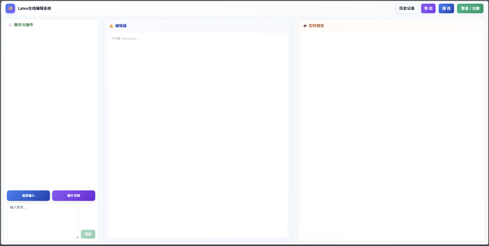

# 介绍

这是一个面向 LaTeX 文档编辑与辅助处理的全栈项目，提供从文本编辑到内容识别、语音转写和智能对话的一体化支持。

## 主要功能

- 文本编辑与实时预览，方便直接编写和检查 LaTeX 内容。
- 图片 OCR 识别，可将图片中的文字快速转换为可编辑文本。
- 语音录制与转写，支持把语音内容转换为文本输入。
- 智能对话辅助，可围绕编辑内容进行问答和内容补全。
- 用户登录与历史记录管理，便于保存和查看之前的使用内容。
- 支持草稿保存，减少意外关闭或刷新带来的内容丢失。

## 使用说明

项目分为前端、后端和 AI 服务三部分，配置好对应的api密钥并启动对应服务后即可在本地完成完整功能体验。

## 主界面

